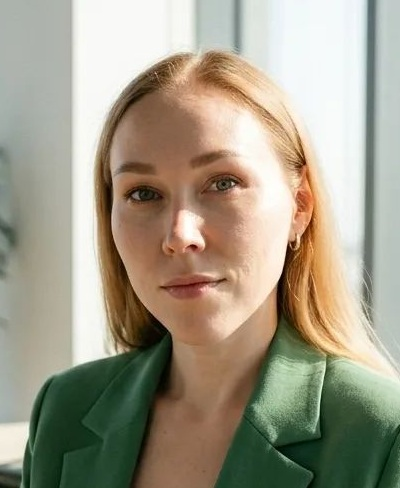

# Софья Спиридонова

**Системный аналитик** · удалённо

[sophyasergeevna@yandex.ru](mailto:sophyasergeevna@yandex.ru) · [GitHub](https://sofia-qa-med.github.io/Sofia-SA-MED.github.io) · [Сетка](https://set.ki/account/TDdZjn6)

---

## О себе
14 лет в разработке и производстве оборудования, из них больше 7 — в медицинской технике. Специализируюсь на анализе и формализации требований к встроенному ПО, аппаратно-программным интерфейсам и медицинским устройствам
Перевожу потребности клиник, продукта, разработки и QA в проверяемые требования, user stories, спецификации и критерии приёмки. Работаю с жизненным циклом изделия: от сбора требований и анализа дефектов до управления изменениями, верификации, валидации и подготовки к серийному производству

## Компетенции
- **Документация:** Сбор, анализ, декомпозиция и приоритизация требований к встроенному ПО и аппаратным системам
- **Требования:** Подготовка SRS, functional specifications, user stories, use cases, acceptance criteria, управление бэклогом, постановка задач разработчикам и тестировщикам
- **Процессы:**
  - моделирование и описание бизнес-процессов
  - Change Management: анализ влияния изменений, актуализация документации, контроль реализуемости
  - Анализ встроенного ПО, пользовательских интерфейсов, аппаратно-программных взаимодействий и интеграций
  - Анализ дефектов, обратной связи пользователей и клинических замечаний; перевод в требования и улучшения продукта
  - Верификация и валидация СМК ISO 13485: сценарии испытаний, приёмочное тестирование, работа с результатами верификации
  - Техническая коммуникация на русском и английском
- **Инструменты:**
  - Управление требованиями: Codebeamer, Devprom ALM, Jira, Redmine
  - Документация: SRS, ТЗ, ТУ, РЭ, спецификации, user stories, Markdown
  - Моделирование: 	UML, BPMN, Draw.io, Figma
  - Встроенные системы: Анализ встроенного ПО, CAN-снифферы, аппаратно-программные интерфейсы
  - Инженерные инструменты: Linux, Bash, SSH, Git, SQL, SQLite, JSON API
  - Качество и процессы: ISO 13485, СМК, верификация, валидация, Change Management
  - Производство: PDM, 1С ERP, технологическая и конструкторская документация
  - Дополнительно: SolidWorks, CorelDRAW, Excel (уровень написания макросов)

## Опыт работы

### Тритон-ЭлектроникС — Системный аналитик
*Июнь 2026 — сейчас · медицинское оборудование*
- Анализирую встроенное ПО, пользовательские интерфейсы и аппаратно-программные взаимодействия аппаратов ИВЛ в рамках модернизации продукта
- Собираю, уточняю, декомпозирую и формализую требования для команды разработки; готовлю задачи, сценарии и критерии приёмки
- Координирую процессы верификации, валидации и приёмочных испытаний; сопровождаю подготовку продукта к серийному производству
- Анализирую обратную связь из клиник и дефекты, выявленные в эксплуатации и испытаниях; преобразую их в требования на улучшение продукта
- Актуализирую нормативно-техническую документацию: ТУ, руководства по эксплуатации, спецификации и сопутствующие документы
- Ставлю задачи тестировщикам, провожу наставничество и контролирую полноту тестового покрытия
- Управляю бэклогом доработок и координирую приоритеты между продуктом, разработкой, QA и производством
- **Результат:** координирую доработку встроенного ПО для вывода аппарата на серийное производство; сокращаю время выхода на рынок за счёт управления бэклогом, требований и процессов верификации/валидации

### Тритон-ЭлектроникС — Инженер-тестировщик
*Май 2025 — Май 2026*
- Тестировала встроенное ПО и интерфейсы аппаратов ИВЛ, включая проверку сценариев работы устройства и взаимодействия программных и аппаратных компонентов
- Разрабатывала методики проверки и сопровождала верификацию ПО сторонними службами
- Анализировала дефекты по итогам медицинских и технических испытаний, определяла причины и готовила материалы для устранения
- Декомпозировала задачи, уточняла требования и актуализировала ТУ и РЭ по результатам разработки и испытаний
- Участвовала в подготовке продукта к серийному производству
- **Результат:** в составе команды провела продукт через медицинские и технические испытания до серийного производства

### Ведал — Ведущий инженер-технолог / менеджер по запуску продукта
*Июнь 2024 — Май 2025*
- Запускала производство медицинского оборудования с нуля
- Разрабатывала СМК для этапов разработки и производства изделия
- Готовила документацию для сертификации медицинской техники
- Выстраивала процесс сбора требований от поставщиков и формировала сквозную технологическую документацию для всех этапов создания продукта
- Отвечала за технологическую готовность изделия к запуску в производство
- **Результат:** выстроила процесс сбора требований от поставщиков и сквозную технологическую документацию; обеспечила технологическую готовность продукта к запуску

### БТЛ — Инженер по документации / Configuration manager
*Август 2019 — Март 2024*
- Выпускала полный пакет производственной и конструкторской документации на английском языке для медицинских изделий, производимых в Европе
- Управляла изменениями документации на этапах R&D и постановки изделия в производство
- Взаимодействовала с европейскими разработчиками и производственными площадками на английском языке
- Обеспечивала согласованность документации, версий, изменений и требований к выпускаемым изделиям
- **Результат:** обеспечила документацию и управление изменениями для релизов линейки медицинских изделий, зарегистрированной и продающейся по всему миру

### Горизонт — Инженер-технолог
*Октябрь 2012 — Июль 2019*
- Разрабатывала технологическую документацию для электромонтажа и сборки приборов
- Формировала инструкции, технические требования и стандарты предприятия
- Проводила нормоконтроль и технологический контроль конструкторской документации
- Обучала и аттестовала персонал, вела архив документации
- **Результат:** многократное успешное прохождение сертификации производства и аудитов

### Меткор — Технолог-программист
*Июль 2012 — Октябрь 2012*
- Разрабатывала программы раскроя листового металла для станков с ЧПУ
- Работала с CNC CAD, AutoCAD и Punch
- **Результат:** Подготовила библиотеки раскроя части номенклатуры деталей для разных типов станков и габаритов материалов

## Проекты
- **[SRS](https://sofia-qa-med.github.io/SRS/)** — макет страницы требований к аппарату ИВЛ в стиле Codebeamer: демонстрирует подход к структуре требований, спецификациям и управлению ими
- **[python_autotests](https://github.com/Sofia-QA-MED/python_autotests)** — пример API-автотестов на pytest + requests
- **[cypress.js](https://github.com/Sofia-QA-MED/cypress.js)** — UI-автотесты регресса на Cypress

## Образование
**Уральский федеральный университет**, 2012
Химико-технологический факультет, химическая технология монокристаллов, материалов и изделий электронной техники, специалист

## Курсы и сертификаты
- **Инженер по тестированию**, "QA Studio", 2025 QA middle
- **Создание СМК ISO 13485**, «Эксперт-гарант», 2025 — аудитор внутренних проверок СМК (до 2028 года)
- **Цифровое производство**, «Цифра», 2019

## Языки
Русский — родной · Английский — B2
